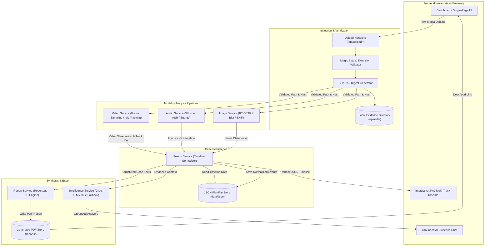

# Data Flow Diagram: CrimeVision AI

## 1. Overview
The CrimeVision AI architecture enforces a strict unidirectional data flow: from initial raw evidence intake and cryptographic hashing, through isolated modality inference pipelines, to unified chronological persistence, and finally to report generation.

---

## 2. System Data Flow Diagram

---

## 3. Implemented vs. Conceptual Components

| Component | Architecture Role | Implementation Status | Notes |
|---|---|---|---|
| **Magic-Byte Validator** | Evidence validation | **Implemented** | [utils/file_utils.py](../src/utils/file_utils.py) |
| **SHA-256 Digest Engine** | Byte comparison support | **Implemented** | [utils/file_utils.py](../src/utils/file_utils.py); a digest does not establish chain of custody |
| **RT-DETR / CV2 Blur** | Visual analysis | **Partially implemented** | [services/image_service.py](../src/services/image_service.py); RT-DETR ran on a synthetic still, while real-evidence accuracy and BLIP/CLIP remain unverified |
| **Whisper ASR Engine** | Acoustic analysis | **Partially implemented** | [services/audio_service.py](../src/services/audio_service.py); cached Whisper transcribed offline-generated speech and persisted a timestamped segment; real-recording accuracy remains unverified |
| **IoU Entity Tracker** | Approximate video tracking | **Partially implemented** | [services/video_service.py](../src/services/video_service.py); tested with mocked detections, not identity recognition |
| **JSON Case Store** | Persistence | **Implemented (prototype)** | [services/fusion_service.py](../src/services/fusion_service.py) writes observations to case JSON files; data persists locally |
| **ReportLab PDF Engine** | Export | **Implemented (prototype)** | [services/report_service.py](../src/services/report_service.py) generates academic prototype reports, not court-ready reports |
| **Groq / Rule Synthesis** | Natural language Q&A | **Partially implemented** | [services/intelligence_service.py](../src/services/intelligence_service.py); local lookup and mocked external responses are tested, live Groq is unverified |
| **SQLite / PostgreSQL** | Relational Database | *Conceptual / Roadmap* | Abstracted behind `FusionService` interface for future migration |
| **RTSP Live Stream Ingress**| CCTV streaming | *Conceptual / Roadmap* | Video service currently analyzes stored container files |

---
*Reference Implementation Files:*
- [utils/file_utils.py](../src/utils/file_utils.py)
- [services/fusion_service.py](../src/services/fusion_service.py)
- [routes/report_routes.py](../src/routes/report_routes.py)
