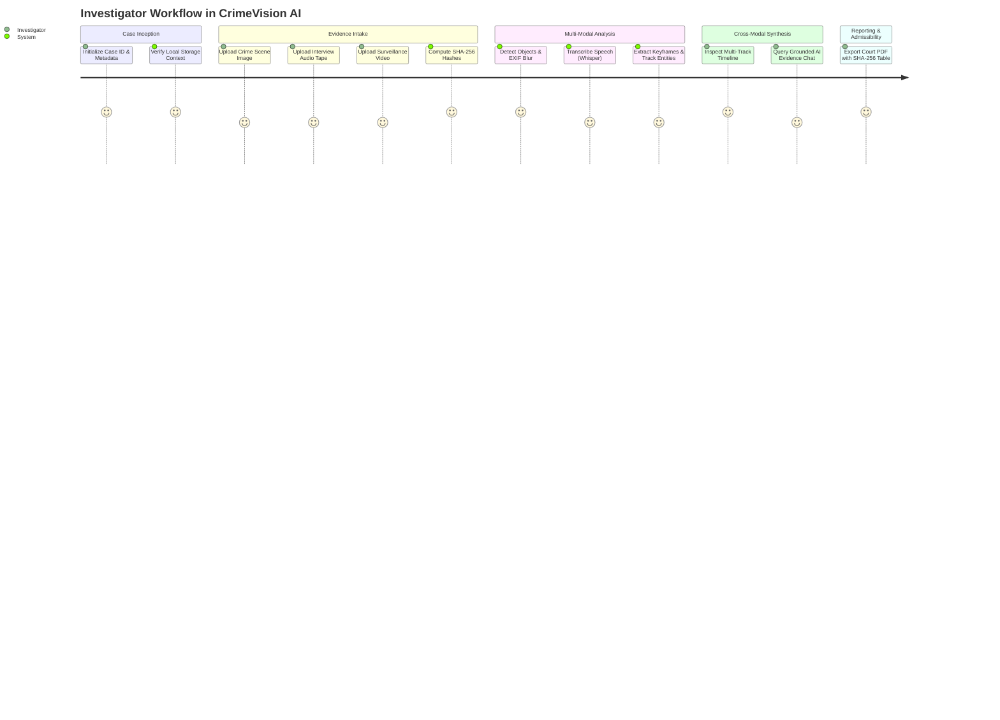

# Investigator Journey Map: CrimeVision AI

## 1. Scope & Workflow Overview
This journey map documents the prototype workflow supported by the current interface and backend. It separates tested behavior from optional or unverified paths and ends with an academic prototype report, not a court report.

---

## 2. End-to-End Investigation Journey

---

## 3. Detailed Journey Phases

| Stage | User Action | System Action | Output / Evidentiary Artifact |
|---|---|---|---|
| **1. Intake** | Enters a case identifier in the sidebar and uploads supported media. | Checks extension/signature where supported, saves the upload, and computes a digest during analysis. | Local evidence file and a recorded digest where analysis completes. A digest does not prove the file is untampered. |
| **2. Visual Analysis** | Selects an image and requests analysis. | Computes image measurements; optional RT-DETR may return semantic detections. Fallback candidate regions are not object labels. | RT-DETR returned one detection on a synthetic image; real-evidence accuracy and browser preview are unverified. |
| **3. Acoustic Analysis** | Uploads a supported audio file. | Optional Whisper can create transcript segments. If unavailable, the fallback stores acoustic measurements and creates no transcript or speech timestamps. | Transcript only when Whisper runs; otherwise an acoustic summary. |
| **4. Video Analysis** | Uploads a supported video file. | Samples bounded-size frames; detections and IoU tracks depend on optional model output. Frame differences may create tentative motion observations. | Keyframes and candidate observations; tracks indicate approximate spatial continuity, not identity. |
| **5. Case Timeline** | Navigates to the Timeline view. | Groups and sorts stored observations by evidence source and timestamp basis. | The loopback demo displayed timeline records; separate files remain unsynchronized and are not cross-file correlated. |
| **6. Case Observation Chat** | Enters a question in Evidence Chat. | Local keyword lookup is the default. A per-message confirmation is required before selected text may be sent to configured Groq. | Tentative responses with citation IDs where available; local lookup is not semantic search and live Groq is unverified. |
| **7. Prototype Report** | Requests a PDF report for a case. | Compiles a local academic prototype PDF with available observations, source details, digests, and limitations. | Prototype report in `reports/`; it is not court-ready or a chain-of-custody record. |

---
*Reference Implementation Files:*
- [templates/index.html](../src/templates/index.html)
- [static/js/dashboard.js](../src/static/js/dashboard.js)
- [services/report_service.py](../src/services/report_service.py)
