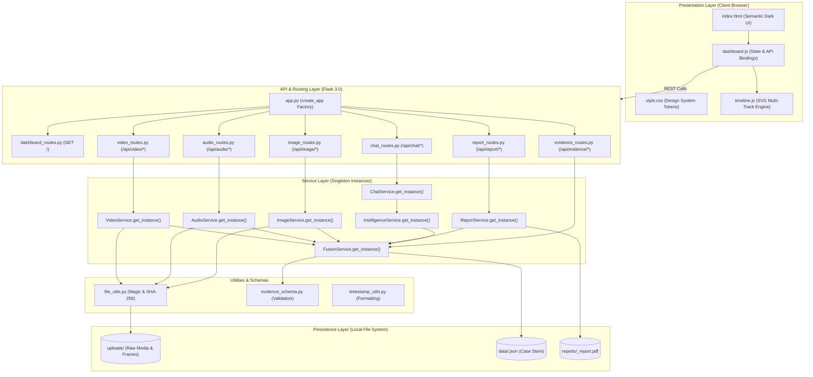

# Solution Architecture: CrimeVision AI

## 1. Architectural Philosophy
CrimeVision AI uses the Flask **Application Factory** pattern and singleton service instances for optional model runtimes. The model paths are designed for lazy loading; startup checks passed, but latency and memory use have not been benchmarked. Provenance fields describe the selected analysis path.

---

## 2. High-Level System Architecture Diagram

---

## 3. Structural Breakdown

### 3.1 Application Factory ([app.py](../src/app.py))
- Instantiates Flask with explicit configuration from `config.py`.
- Registers seven dedicated Blueprints (`dashboard`, `image`, `audio`, `video`, `evidence`, `chat`, `report`).
- Configures error handlers (`400`, `404`, `413`, `500`) returning consistent JSON responses.
- Provides `/api/health` and `/api/models/status` endpoints returning system and optional-service status without exposing API keys.

### 3.2 Blueprint Organization ([routes/](../src/routes/))
Each route module is strictly isolated to its evidentiary modality:
- `image_routes.py`: File upload, validation, and invocation of `image_service`.
- `audio_routes.py`: Audio intake, Whisper transcription, and acoustic analysis.
- `video_routes.py`: Video intake, keyframe extraction, and IoU tracking.
- `evidence_routes.py`: Timeline retrieval, case listing, and case deletion. The DELETE route is unauthenticated and should only be used in a trusted local session; this audit did not call it.
- `chat_routes.py`: Natural language Q&A scoped to case observations.
- `report_routes.py`: Generation and download of academic prototype PDF documents.

### 3.3 Singleton Service Organization ([services/](../src/services/))
- Optional runtimes (RT-DETR, Whisper, CLIP, and Groq clients) are managed through service instances.
- **Lazy Loading**: Model weights may load on first use and may require network access. No weight-loading path was run in the safe audit suite.

### 3.4 Shared Utilities ([utils/](../src/utils/))
- `file_utils.py`: Enforces upload-size and extension checks, validates supported signatures, and computes SHA-256 digests for later comparison.
- `evidence_schema.py`: Defines `TypedDict` observation shapes, a dictionary factory, and basic required-field/confidence validation; it does not validate the truth of evidence.
- `timestamp_utils.py`: Formats media-relative numeric offsets for display. Times from separate files are not synchronized.

---
*Reference Implementation Files:*
- [app.py](../src/app.py)
- [config.py](../src/config.py)
- [routes/__init__.py](../src/routes/__init__.py)
- [services/__init__.py](../src/services/__init__.py)
