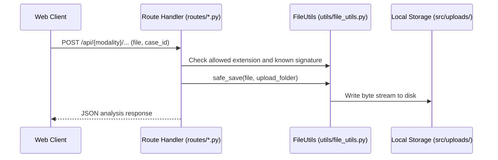

# Implementation Walkthrough: CrimeVision AI

## 1. Overview
This document provides a technical walkthrough of the core processing pathways implemented in CrimeVision AI, citing exact files, classes, and methods.

---

## 2. Ingestion & Cryptographic Verification Pathway

When the dashboard submits a media file via `/api/image/analyse`, `/api/audio/transcribe`, or `/api/video/analyse`:

1. **Filename Handling**: `secure_filename()` is used before a generated evidence UUID is used as the saved filename.
2. **Signature Check**: Known media signatures are checked where implemented; this is basic validation, not a full malware scan or proof of file origin.
3. **Content Digest**: `file_sha256()` reads the file in chunks and records a digest for later byte comparison. It does not make storage immutable or prove chain of custody.

---

## 3. Visual Forensics Processing Pathway ([services/image_service.py](../src/services/image_service.py))

Invoked via `ImageService.analyse(image_path, case_id, evidence_id)`:

1. **Forensic Image Metrics (`_extract_forensic_metadata`)**:
   - Converts image to grayscale using OpenCV.
   - Computes Laplacian variance:
     $$\text{Var} = \sigma^2(\nabla^2 I)$$
     If $\text{Var} < 100.0$, the image is flagged as potentially blurry or out-of-focus.
   - Computes mean color intensity and standard deviation to detect extreme exposure conditions.
2. **Object Detection**:
   - Optional: When RT-DETR is loaded, its returned labels, boxes, and scores are reported and an annotated copy is saved.
   - Fallback: OpenCV contour regions are returned separately as candidates; they are not semantic object detections.
3. **Observation Persistence**:
   - Observations are created using `src/utils/evidence_schema.py` and saved to the local case JSON via `FusionService.save_observations()`.

---

## 4. Acoustic Forensics Processing Pathway ([services/audio_service.py](../src/services/audio_service.py))

Invoked via `AudioService.transcribe(audio_path, case_id)`:

1. **Speech Recognition (Whisper)**:
   - Optional: Uses local Whisper when its model is loaded, returning language and time-coded transcript segments.
   - Fallback: When Whisper is unavailable or inference fails, only acoustic measurements are retained; the service does not fabricate transcript text or speech timestamps.
2. **Timeline Insertion**:
   - Transcript timestamps are relative to the audio file and are stored with the source evidence ID. A separately uploaded audio and video file are not synchronized.

---

## 5. Video Forensics & Entity Tracking Pathway ([services/video_service.py](../src/services/video_service.py))

Invoked via `VideoService.analyse(video_path, case_id, evidence_id)`:

1. **Keyframe Sampling**:
   - Samples at a configurable interval, with a maximum frame count and frame-pixel limit.
   - Downscales saved frames to a maximum 1280-pixel side and writes them to `src/uploads/frames_<evidence_id>/`.
2. **Optional Detection and IoU Association**:
   - When a semantic model produces detections, bounding boxes can be associated across nearby sampled frames using Intersection over Union:
     $$\text{IoU}(A, B) = \frac{\text{Area}(A \cap B)}{\text{Area}(A \cup B)}$$
   - IDs indicate approximate spatial continuity only; they do not identify a person. Heuristic contours are candidate regions and are not tracked as objects.
3. **Frame-change Observations**:
   - Sampled frame differences can produce tentative scene-change observations. This is not action recognition, and intervals not sampled are not described.

---

## 6. PDF Report Compilation Pathway ([services/report_service.py](../src/services/report_service.py))

Invoked via `ReportService.generate(case_id, output_path)`:

1. **Data Retrieval**: Fetches all case observations from `FusionService.get_case(case_id)`.
2. **ReportLab Document Assembly**:
   - Includes case metadata, source evidence inventory, source IDs, file-relative timestamps and analysis time, recorded observations, digest values where available, and uncertainty/limitations.
   - Includes page numbers and a notice that the report is an academic prototype, not a legally validated report.
3. **Output**: The route saves a local PDF under `src/reports/`. Existing reports are not silently overwritten.

---
*Reference Implementation Files:*
- [services/image_service.py](../src/services/image_service.py)
- [services/audio_service.py](../src/services/audio_service.py)
- [services/video_service.py](../src/services/video_service.py)
- [services/report_service.py](../src/services/report_service.py)
